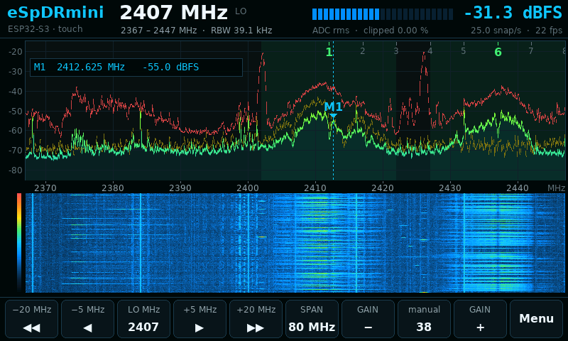
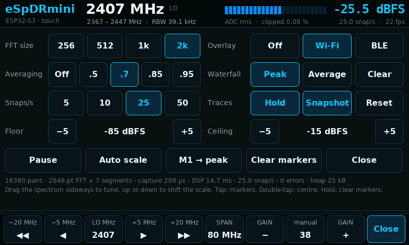

# eSpDRmini LCD

**A standalone 2.4 GHz spectrum analyser on the Waveshare
ESP32-S3-Touch-LCD-4.3: no PC, just power over USB.**

The board's own ESP32-S3 is the receiver. It captures raw IQ with
[esp-sdr](https://github.com/ESPARGOS/esp-sdr)'s receiver code, computes the
spectra on-chip and draws them on the 800 × 480 touchscreen: live spectrum
(average, this snapshot, peak hold), a waterfall, a level meter, Wi-Fi and
Bluetooth LE channel overlays and markers. It uses the same look and colours
as the desktop viewer.

| | |
|---|---|
| Tuning | 1842–2850 MHz, 1 MHz steps (below 2210 MHz with esp-sdr's 5/6 LO mode) |
| Span | 80, 40 or 16 MHz (80, 40, 16 MS/s) |
| Snapshot | 16,380 contiguous IQ pairs: 205 µs at 80 MS/s, 410 µs at 40, 1.02 ms at 16 |
| Snapshots | 5, 10, 25 or 50 per second |
| FFT | 256–2048 points (RBW 39 kHz at 80 MS/s, 7.8 kHz at 16 MS/s with 2048) |
| Display | redrawn for each snapshot, and every refresh (39 Hz) while you touch it |

Like the rest of eSpDRmini, it shows a series of short looks at the band, not
a continuous stream: what happens between snapshots is missed. Levels are
dBFS, not calibrated power.

## Hardware

Waveshare **ESP32-S3-Touch-LCD-4.3**: ESP32-S3 with 8 MB octal PSRAM and
8 MB flash, an 800 × 480 RGB panel, a GT911 touch controller and a CH422G IO
expander. (The 4.3B is a different board and hasn't been tried.) Use the
USB-C port wired to the chip's native USB, which appears with vendor ID
`303a`, not the USB-to-UART one.

The radio uses the board's PCB antenna. Waveshare's demo pinout is used; the
one thing worth knowing is that the CH422G's EXIO5 switches GPIO19/20 between
the USB connector and the CAN transceiver. The firmware keeps it low, so USB
keeps working.

## Using it

**Bottom bar**

| Button | Action |
|---|---|
| ◀◀ ◀ ▶ ▶▶ | tune by the step shown (5/20 MHz at 80 MHz span, 2/10 at 40, 1/4 at 16); hold to repeat |
| LO | keypad: type a frequency in MHz, or pick a preset (Wi-Fi 1/6/11, the whole 2.4 GHz band, BLE 39) |
| SPAN | 80 → 40 → 16 MHz |
| GAIN − / + | gain-table index (hold to repeat). 35–55 suits indoor 2.4 GHz; the level meter turns red when the ADC clips |
| GAIN (middle) | manual gain ↔ the chip's hardware AGC. Manual (40) is the default: the AGC chases Wi-Fi packets and clips on quiet bands |
| Menu | display settings (below) |

**On the spectrum and waterfall**

| Gesture | Action |
|---|---|
| drag sideways | tune; the traces and the waterfall history move with the frequency axis |
| drag up or down (spectrum) | shift the level scale |
| tap (spectrum) | place marker M1, then M2; later taps move the nearer one. A marker snaps to the strongest point near your finger and reads its frequency from the FFT bin. With both set, the readout shows Δf and Δ level (an SNR, with M2 on the noise floor) |
| double-tap | centre on that frequency |
| press and hold (spectrum) | clear the markers |

**Menu**

FFT size, averaging of the average trace (0 to 0.95), snapshots per second,
the Wi-Fi or BLE overlay, whether waterfall rows show each snapshot's peak or
its mean, the peak-hold and this-snapshot traces (and resetting the hold),
floor and ceiling (they set both the spectrum scale and the waterfall
colours), pause, auto scale, M1 to the strongest peak and clearing markers.
The bottom line shows the receiver's figures: capture time, DSP time, rate,
errors and free memory.

Settings are saved to flash 3 s after the last change and restored at power-on.

## Build and flash

This directory is an ESP-IDF project. It needs esp-sdr, a git submodule (with
ESP-DSP inside it), and the ESP-IDF commit that esp-sdr pins for the S3
(`25fe69f9`, v6.1-dev):

    git submodule update --init --recursive
    git clone https://github.com/espressif/esp-idf ~/esp/esp-idf
    cd ~/esp/esp-idf && git checkout 25fe69f946311abdaf9ad56591f25fedbc20ac98
    git submodule update --init --recursive && ./install.sh esp32s3
    . ~/esp/esp-idf/export.sh

    cd lcd
    idf.py build
    idf.py -p /dev/ttyACM0 flash          # macOS: /dev/cu.usbmodem*

Flashing replaces the board's demo firmware. Back it up first if you want it
back later, and restore it the same way:

    python -m esptool read-flash 0 ALL waveshare-4.3-backup.bin
    python -m esptool write-flash 0 waveshare-4.3-backup.bin

`tools/mkfont.py` regenerates `main/fonts.c` (anti-aliased DejaVu bitmaps);
you only need it to change fonts or sizes.

### Testing over USB

The firmware answers simple line commands on its USB port, which
`tools/lcdctl.py` (run with the repository's virtualenv) speaks:

    python tools/lcdctl.py stat                    # receiver and display figures
    python tools/lcdctl.py shot screen.png         # save what the display shows
    python tools/lcdctl.py tap 755 449             # a synthetic touch (here: Menu)
    python tools/lcdctl.py swipe 600 150 300 150   # a drag

The screenshots in this README were taken that way.

## How it works

    core 0                                      core 1
    ┌───────────────────────────────┐           ┌────────────────────────────────────────┐
    │ esp-sdr receiver: tune, gain, │  spectra  │ touch (GT911, I2C) → settings          │
    │ capture 16,380 IQ pairs into  │ ────────▶ │ draw 30 strips of 16 lines in SRAM     │
    │ SRAM, 0.2–1 ms                │  + wf row │   ──GDMA──▶ frame buffer (PSRAM)       │
    │ DSP: Blackman, 2048-pt FFTs,  │           │                                        │
    │ mean/peak per bin, columns,   │           │ LCD bounce buffers (SRAM) ◀──GDMA──    │
    │ averaging, peak hold: 14.5 ms │           │   frame buffer, 10 lines at a time     │
    └───────────────────────────────┘           └────────────────────────────────────────┘

* **Receiver** (`radio.c`): esp-sdr's S3 receiver, adapted from its
  `main/targets/esp32s3/receiver.c`, with its serial protocol replaced by a C
  API. Wi-Fi is started only to bring up and calibrate the PHY. Each retune
  remeasures the receive DC offset at the new LO using esp-sdr's
  `rx_recalibration.c`, which is compiled from the submodule. A capture hands
  SRAM bank 4 (`0x3fcd0000`, 64 KiB, reserved from the heap) to the radio's
  dump engine, which fills it with 10-bit I/Q at 80, 40 or 16 MS/s.
* **DSP** (`dsp.c`): as in the desktop viewer. Remove DC, mirror (the S3's
  raw I + jQ has RF = LO − f), split into contiguous N-point segments, apply a
  Blackman window and run ESP-DSP's FFT. The mean over segments gives the
  average trace (then smoothed across snapshots) and the maximum gives the
  snapshot and peak-hold traces. Each of the 760 display columns takes its
  strongest bin.
* **Display** (`board.c`, `ui.c`, `render.c`, `gfx.c`): the panel scans out
  continuously from a frame buffer in PSRAM, so the firmware has to keep PSRAM
  bandwidth and the CPU free for that:
  * The UI draws each frame as 30 strips of 16 lines in internal SRAM, and a
    GDMA channel copies each strip into the PSRAM frame buffer. The CPU never
    touches PSRAM for pixels.
  * The LCD reads from two 10-line bounce buffers in SRAM. Two more GDMA
    channels refill them from the frame buffer, so a refill costs no CPU time.
    Without bounce buffers the LCD reads PSRAM directly, runs short whenever
    PSRAM is busy and shifts the picture sideways. Refilling them by CPU copy,
    as the driver does with its own frame buffer, takes most of a core.
  * Strips whose content hasn't changed (the button bar, usually) aren't
    redrawn. A frame is drawn only for a new snapshot, or at every refresh
    while the screen is touched.
* **Shared state** (`sdr.c`): settings go to core 0; spectra come back
  through triple buffering. Waterfall rows are kept as 8-bit levels, so a
  change of floor or ceiling recolours the whole history. Each row also keeps
  its LO, so the history stays aligned after you retune.

Measured on the board: snapshots at the chosen rate up to 50/s, capture
205 µs at 80 MS/s, DSP 14.5 ms for 7 × 2048-point FFTs, drawing a full frame
about 23 ms, bounce refills 290 µs on average.

## Licence

This directory is licensed under the **GNU General Public License v3.0 or
later** ([LICENSE](LICENSE)). `radio.c` is adapted from esp-sdr, and the
firmware links esp-sdr's receive-calibration code; esp-sdr is GPL-3.0-or-later.
The rest of eSpDRmini outside `lcd/` stays under its Zero-Clause BSD licence.

* [esp-sdr](https://github.com/ESPARGOS/esp-sdr) by Florian Euchner
  (ESPARGOS), Zoltan Doczi and contributors: the receiver, used as a
  submodule. Thank you.
* [eSpDR](https://github.com/h0m3us3r/eSpDR) by h0m3us3r, whose discovery and
  bank-rotation work esp-sdr's S3 support builds on.
* ESP-IDF and ESP-DSP: Apache License 2.0, Espressif Systems.
* The fonts are rendered from DejaVu Sans and DejaVu Sans Mono (Bitstream Vera
  and DejaVu licences), as shipped with matplotlib.
* Board pinout and panel timings from Waveshare's ESP-IDF demo for this board.
